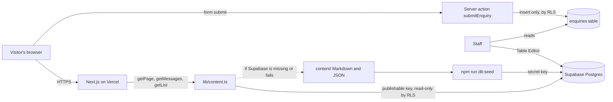

# Architecture

The website is a Next.js 16 App Router application. Pages are React Server Components that read content through one loader, render to static HTML at build time, and refresh in the background every 5 minutes. Supabase stores the content and the form submissions.

## Code structure

- **UI primitives**: `components/ui/` holds shadcn/ui components (Radix-based where interaction needs it). `components.json` lets the shadcn CLI add more.
- **Feature components**: `components/features/<area>/`, composed from the primitives. Every component stays under 150 lines.
- **Server Actions**: `actions/enquiry.ts` handles all form submissions.
- **Boundaries**: `app/error.tsx` (route errors with retry), `app/global-error.tsx` (root layout failures), `app/loading.tsx` (skeleton while data loads), `app/not-found.tsx`.

## Supabase clients

| Client | File | Used for |
| --- | --- | --- |
| Public (cookie-free) | `lib/supabase/public.ts` | Reading public content in Server Components; keeps pages statically cached |
| Server (`@supabase/ssr`) | `lib/supabase/server.ts` | Server Actions and, later, signed-in staff pages; reads and refreshes session cookies |
| Browser (`@supabase/ssr`) | `lib/supabase/client.ts` | Client Components that need live data or auth |

All three are typed with `Database` from `lib/database.types.ts`, which is generated with `npm run db:types`. When staff sign-in is added, add a `proxy.ts` that refreshes the Supabase session on each request.

## Theming

`app/globals.css` defines shadcn-style CSS variables (`--background`, `--card`, `--primary`, `--muted-foreground`, ...) for `:root` and `.dark`, plus HKBK brand and section tones. `next-themes` sets the `dark` class on `<html>` from the visitor's system setting or the toggle in the header, and remembers the choice. Components use tokens only, so both themes stay consistent.

## Content flow

1. Staff edit content in the Supabase dashboard, or developers edit files in `content/` and run `npm run db:seed`.
2. Each page calls the loader in `lib/content.ts`:
   - `getPage(slug)` for page text (`pages` table or `content/pages/<slug>.md`)
   - `getMessages()` and `getMessage(slug)` for leadership messages
   - `getList(table)` for departments, dashboards, projects, programmes, facilities and news
3. If Supabase is not configured, or a query fails, the loader reads the same content from `content/` and logs a warning. The site never shows an empty page because of a database problem.

## Rendering and caching

- Every content page sets `export const revalidate = 300`. Next.js serves static HTML and regenerates it in the background at most every 5 minutes.
- `POST /api/revalidate` with the `x-revalidate-secret` header refreshes all pages at once. Connect it to a Supabase database webhook so edits appear immediately (see [DEPLOYMENT.md](DEPLOYMENT.md)).
- `/leadership/[slug]` pages are generated for every message at build time with `generateStaticParams`.

## Forms

All forms use `components/EnquiryForm.tsx` and one server action, `submitEnquiry` in `app/actions.ts`.

- The server action validates input, rejects bots through a hidden honeypot field, requires consent, and inserts one row into `enquiries`.
- Common fields (name, email, phone, message) are columns. Form-specific fields, such as organisation or training programme, go into the `details` JSON column.
- Row-level security allows the public key to **insert** enquiries and nothing else. Nobody can read enquiries through the public API.

## Security

- The browser never receives a Supabase key with write access to content.
- Row-level security is on for every table: public read for content, insert-only for enquiries.
- The secret key is used only by the seed script on a developer's machine.
- Vercel serves the site over TLS 1.3 with hybrid post-quantum key exchange (X25519MLKEM768) for supporting browsers, which matches the Quantum Ready commitment.

## Design system

White pages with coloured elements. Each part of the site has one colour, used for its panel edges, active tab, icons and the line under the page banner, so colour always tells visitors where they are.

| Token | Value | Use |
| --- | --- | --- |
| `brand` | `#123E7C` | Navigation bar, headings, primary buttons |
| `brand-dark` | `#0A2A57` | Utility bar, footer, heading text |
| `gold` | `#F2A900` | Admission enquiry buttons, active navigation tab |
| `t-blue` | `#1A4F9C` | About |
| `t-green` | `#1E7A4C` | Programmes and Departments |
| `t-teal` | `#0B7480` | AI and quantum |
| `t-amber` | `#925700` | R & D |
| `t-rose` | `#A3253D` | Campus Life |
| `t-violet` | `#5B3FA6` | Labs |
| `ink`, `muted`, `line`, `surface` | greys | Text, secondary text, borders, light backgrounds |

Page structure:

- **Header**: the main menu sits at the very top in a sticky navy bar: Home, About, Programmes, Departments, Centre of Excellence, IEEE, Houses, Placements, AI & Quantum Campus, IDEA Lab, IQAC. Items with sub-items open a mega menu (link columns plus a feature card). Every item is always shown on the bar: on screens narrower than 1280px the items wrap onto more lines and dropdowns open on tap or click instead of hover. Below it is a white logo row with the affiliation, approval and address. The footer has a brand and contact block and six link columns (About HKBK, Programmes, Departments, Centre of Excellence, Student life, AI and quantum), built from the same menu tree by `components/features/layout/footer-columns.ts`.
- **Home**: hero with the campus photograph, big numbers with count-up (years, students, faculty, papers, patents, AI Champions and Ambassadors, placements), a quick access panel of colour-coded tiles, the at-a-glance band, vision and mission, full leadership messages one below the other, the AI-First Campus paragraphs with the AI Champions figures beside tabbed news and events, section panels, and a departments panel.
- **Inner pages**: a banner with breadcrumb, then the content at full container width (no left panel), grouped into `Panel`s and `Tabs`.

Tabs (`components/Tabs.tsx`) follow the WAI-ARIA tabs pattern: arrow keys move between tabs, every panel is in the HTML for search engines, and a matching URL hash opens a tab directly (`/consultancy#enquire`, `/academics/cse#research-centre`).

Images and infographics: the campus image is a photograph of the college building; the AI and quantum images are original illustrations rendered from SVG. Infographics (`components/Infographics.tsx`) are drawn from live data or documented facts: the at-a-glance band counts departments, BE programmes and research centres and shows the AI Champions and Ambassadors targets; the dashboards donut counts rows by category; the quantum-safe timeline uses NIST dates.

Navigation: `lib/menu.ts` (`buildMenu`) defines the menu once as a tree; `lib/menu-server.ts` (`getMenu`) loads the departments, leaders, houses and centres it lists. The top menu, the footer and the page banners all render from it.

Light and dark mode: every colour is a token that switches with the theme; section colours used as text have a lighter dark-mode variant. Glass surfaces (frosted, translucent panels with a soft glow) are used on the menu bar, the photo caption, the big-numbers band and the mega menus.

Type is IBM Plex Sans throughout, with IBM Plex Serif for leadership letters. Fonts are self-hosted through Fontsource, so no request goes to Google Fonts. Icons come from `lucide-react`.
