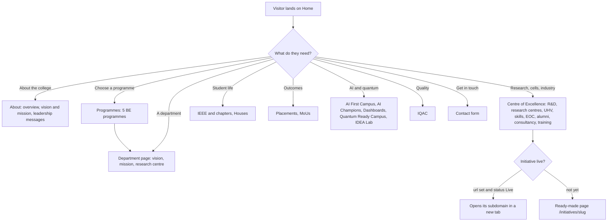
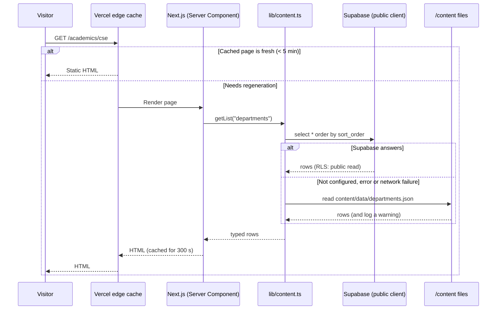
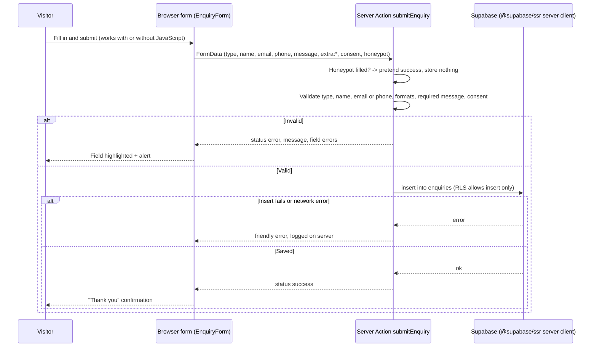
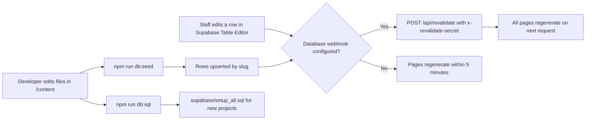
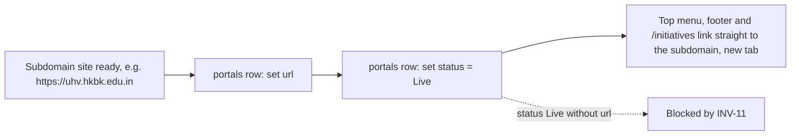
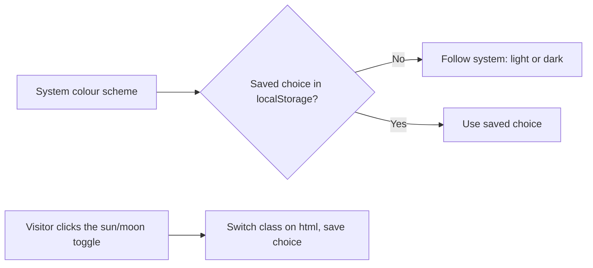
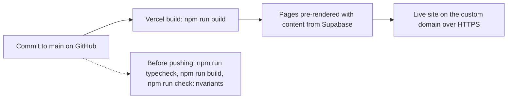
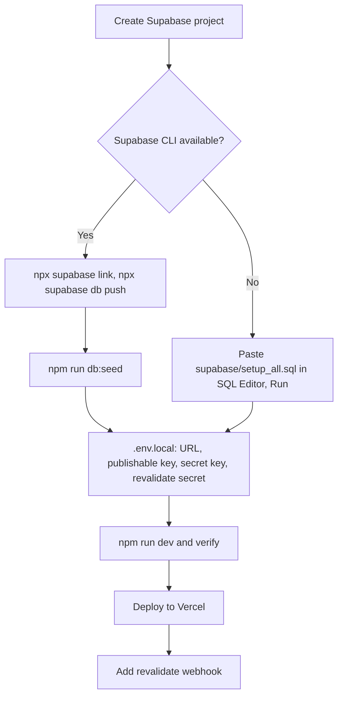

# Flows

How visitors move through the site and how data moves through the system. Diagrams use Mermaid, which GitHub renders.

## 1. Visitor navigation

Navigation surfaces, all built from one menu tree (`lib/menu.ts`):

| Surface | Behaviour |
| --- | --- |
| Top menu bar | 13 items. At 1280px and wider: one row, dropdowns open on hover or keyboard focus. Narrower: items wrap, dropdowns open on tap or click; Escape or a click outside closes them |
| Mega menus | Columns of links plus a feature card (picture, short text, button) |
| Footer | Six columns: About HKBK, Programmes, Departments, Centre of Excellence, Student life, AI and quantum |
| Breadcrumb banner | Home > section > page, coloured by section |

## 2. Reading content (every page view)

## 3. Submitting an enquiry

Staff then read the row in Supabase > Table Editor > `enquiries` and move `status` from `new` to `in_progress` to `closed`.

## 4. Editing and publishing content

## 5. Taking a centre or initiative live

## 6. Theme

## 7. Deployment

## 8. First-time setup

Step-by-step instructions: `docs/SETUP.md`, `docs/DEPLOYMENT.md`, and the agent prompt in `docs/AGENT_SETUP_PROMPT.md`.
