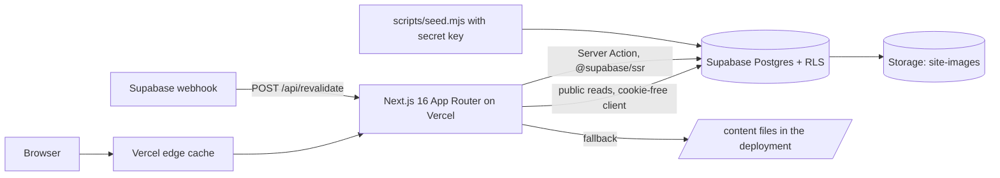

# Master specification

The complete technical specification of the HKBK College of Engineering website, version 0.17.0. Product scope is in `prd.md`; design in `design.md`; decisions in `decision.md`; security in `security.md`. A generated file-by-file inventory is in `manifest.md`.

## 1. Overview

A public website for HKBK College of Engineering, Nagawara, Bengaluru, positioning the college as an AI First and Quantum Ready campus. Static, fast pages read content from Supabase (falling back to files); three enquiry forms write to Supabase through a Server Action. Centres and initiatives link out to their own subdomain sites when live.

## 2. Architecture



| Layer | Technology |
| --- | --- |
| Framework | Next.js 16.3 (App Router, React Server Components, Server Actions), React 19.3, TypeScript 5.9 strict |
| Styling | Tailwind CSS 4.3 with CSS-variable tokens, `@tailwindcss/typography`, `tw-animate-css` |
| UI | shadcn/ui primitives (Radix Tabs, Label, Separator, Slot), lucide-react icons, IBM Plex Sans and Serif (Fontsource) |
| Theme | next-themes (class strategy, system default) |
| Data | Supabase Postgres with RLS; `@supabase/supabase-js` 2.117; `@supabase/ssr` 0.12 |
| Content | Markdown with front matter (gray-matter, react-markdown, remark-gfm); JSON lists |
| Hosting | Vercel (recommended); Supabase region South Asia (Mumbai) recommended |

## 3. Repository layout

```
app/                  Routes, root layout, error, global-error, loading, not-found, sitemap, robots, API route
actions/              Server Actions (enquiry.ts)
components/ui/        shadcn/ui primitives
components/features/  Domain components: layout, navigation, home, content, people, departments,
                      forms, infographics, initiatives, mous
lib/                  content loader, menu tree, site settings, tones, types, Supabase clients, utils
content/              pages/*.md, messages/*.md, data/*.json (seed and fallback content)
public/images/        logo, campus photograph, illustrations
supabase/             migrations/*.sql, setup_all.sql (generated)
scripts/              seed.mjs, build-setup-sql.mjs, check-invariants.mjs, build-manifest.mjs
docs/                 this documentation set
```

## 4. Routes

| Route | Purpose | Data |
| --- | --- | --- |
| `/` | Home: hero, big numbers, quick access, vision and mission, leadership messages, AI-First Campus, notices, research and industry, departments, visit | `leadership_messages`, `departments`, `news_items`, `key_figures`, `ai_people`, page `home-ai-first`, `vision-mission` |
| `/about` | Overview (with campus photo), vision and mission, leadership tabs | pages `about`, `vision-mission`; messages |
| `/leadership` | All leadership messages in full | `leadership_messages` (section `leadership`) |
| `/leadership/[slug]` | One message | `leadership_messages` |
| `/programmes` | Five BE programmes | `departments` where `programmes = 'BE'` |
| `/academics` | All departments by kind | `departments`, page `academics` |
| `/academics/[slug]` | Department: vision and mission, overview, research centre | `departments` |
| `/research` | Research and development, projects | `research_projects`, page `research` |
| `/research/centres` | Six research centres | `departments` where `has_research_centre` |
| `/consultancy` | Services, recent projects, request form | `consultancy_projects`, `departments`, page `consultancy` |
| `/corporate-training` | Why train with us, programmes, enquiry form | `training_programs`, page `corporate-training` |
| `/initiatives` | All centres and initiatives, one tab each | `portals`, page `initiatives` |
| `/initiatives/[slug]` | Ready-made page until the subdomain is live | `portals` |
| `/uhv` | Universal Human Values information | page `uhv`, `uhv_activities`, `portals` |
| `/ieee` | IEEE Student Branch and chapters (tabs) | page `ieee`, `portals` |
| `/houses` | Five houses (tabs) | `houses`, page `houses` |
| `/placements` | Placement figures and preparation | `key_figures`, page `placements` |
| `/mous` | MoU count, scope and directory | `mous`, `key_figures`, page `mous` |
| `/ai-quantum` | AI and quantum overview with dashboards chart | `dashboards`, page `ai-quantum` |
| `/ai-quantum/ai-first` | AI First Campus page | page `ai-first` |
| `/ai-quantum/champions` | 15 AI Faculty Champions (cards, with `?edit=1` editor) and 50 AI Student Ambassadors | `content/champions.json`, `ai_people` (ambassadors), page `ai-champions` |
| `/ai-quantum/quantum-lab` | Quantum Ready Campus: lab, steps, quantum-safe timeline | page `quantum-lab` |
| `/ai-quantum/dashboards` | Dashboards hub by category | `dashboards`, page `dashboards` |
| `/iqac` | IQAC tabs | page `iqac` |
| `/news` | News and events tabs | `news_items`, page `news` |
| `/contact` | Address, map, contact form | page `contact` |
| `/api/revalidate` | POST with `x-revalidate-secret`; refreshes all pages | none |
| `/portals` | Permanent redirect to `/initiatives` | none |
| `/sitemap.xml`, `/robots.txt` | Generated | all slugs |

Every content route exports `revalidate = 300`. Dynamic routes pre-render all known slugs with `generateStaticParams`.

## 5. Navigation

Defined once in `buildMenu()` (`lib/menu.ts`); loaded by `getMenu()` (`lib/menu-server.ts`).

| # | Item | Tone | Contents |
| --- | --- | --- | --- |
| 1 | Home | blue | `/` |
| 2 | About | blue | Overview, Vision and mission, Leadership messages; Chairman's, Director's and Principal's messages (with names). Feature: campus photo |
| 3 | Programmes | green | Five BE programmes, All programmes |
| 4 | Departments | green | Engineering (5), Basic sciences and humanities (4), Physical education (1), All departments |
| 5 | Centre of Excellence | amber | Research and industry (R&D, Research centres, Research projects, Consultancy projects, Corporate training); Research centres (6); Centres and cells (UHV, Skill Development Centre, Equal Opportunity Cell, Alumni Network) |
| 6 | IEEE | rose | About the branch, Activities, Membership (Branch website when live); Chapters: CIS, WIE, Information Theory Society, Education Society |
| 7 | Houses | violet | Five houses ("Name coming soon" for placeholders) |
| 8 | Placements | blue | `/placements` |
| 9 | MoUs | amber | `/mous` |
| 10 | AI First Campus | teal | AI First Campus, AI Champions and Ambassadors, Dashboards. Feature: AI illustration |
| 11 | Quantum Ready Campus | teal | `/ai-quantum/quantum-lab` |
| 12 | IDEA Lab | amber | Subdomain when live, else `/initiatives/idea-lab` |
| 13 | IQAC | blue | `/iqac` |

`sectionFor(path, menu)` decides the active menu item, the banner colour and the breadcrumb. `/academics/*` always maps to Departments; `/initiatives/*` to Centre of Excellence.

## 6. Data model

All tables: RLS on; content tables readable by `anon` and `authenticated`; `slug` unique; `sort_order` for ordering; `updated_at` maintained by trigger. Full columns: `manifest.md` and `lib/database.types.ts`.

| Table | Purpose | Key columns and constraints | Seed rows |
| --- | --- | --- | --- |
| `pages` | Markdown page bodies | `slug` PK, `title`, `summary`, `body_md` | 23 |
| `leadership_messages` | Messages | `slug` PK, `name`, `designation`, `organisation`, `excerpt`, `photo_url`, `body_md`, `section` (`leadership` or `ai-first`) | 4 |
| `departments` | Departments, programmes, research centres | `kind`, `programmes` (`BE` = programme), `vision`, `mission text[]`, `has_research_centre`, `research_areas text[]` | 10 |
| `key_figures` | Big numbers | `label`, `value int` (null = calculated or pending), `suffix` | 11 |
| `portals` | Centres and initiatives | `url` (http/https), `status` (`Live`, `Coming soon`), `category`, `icon`, `related_page`, `menu_group` | 7 |
| `houses` | Student houses | `namesake`, `about`, `motto`, `is_placeholder` | 5 |
| `journey_milestones` | Home page AI journey timeline | `period`, `title`, `summary`, `points text[]`, `badge`, `icon`, `photos jsonb` | 4 |
| `mous` | MoUs | `partner`, `partner_type` (`Industry`, `Academic`, `Research`, `Government`), `purpose`, `signed_on`, `valid_until`, `document_url`, `logo_url` | 0 |
| `ai_people` | Student ambassadors (faculty champions are in `content/champions.json`) | `name`, `role` (`Student ambassador`), `department`, `photo_url`, `bio` | 0 |
| `editors` | Staff allowed to edit | `user_id` (auth user), `email`, `role` | 0 |
| `dashboards` | Dashboards hub | `category`, `status`, `url` | 7 |
| `news_items` | News and events | `kind` (`news`, `event`), `published_on`, `event_date`, `is_sample` | 4 |
| `research_projects` | R&D projects | `investigator`, `funding_agency`, `status`, `year`, `is_sample` | 3 |
| `consultancy_projects` | Consultancy | `client`, `department`, `status`, `is_sample` | 3 |
| `training_programs` | Corporate training | `track`, `duration`, `mode`, `audience`, `is_sample` | 8 |
| `uhv_activities` | UHV activities | `activity_type` | 6 |
| `hostel_facilities` | Unused (ADR-019) | | 0 |
| `enquiries` | Form submissions | `type` (6 allowed), `name` 2-200, `email` ≤200, `phone` ≤30, `message` ≤4000, `details jsonb`, `status` (`new`, `in_progress`, `closed`); email or phone required. Insert-only for the public | n/a |

Storage: public bucket `site-images` for photographs and logos.

Migrations (in order): `init`, `portals`, `departments_ai_people`, `message_section`, `key_figures`, `initiative_menu_group`, `houses`, `mous`. `supabase/setup_all.sql` bundles them with all content.

## 7. Content model

| Location | Format | Front matter / fields |
| --- | --- | --- |
| `content/pages/<slug>.md` | Markdown | `title`, `summary`, `status` (`draft` or `approved`). `## ` headings become tabs on IEEE and IQAC and panels on Vision and mission |
| `content/messages/<slug>.md` | Markdown | `name`, `designation`, `organisation`, `section`, `excerpt`, `photo_url`, `sort_order`, `status` |
| `content/data/<table>.json` | JSON array | Columns of the matching table (without `id` and `updated_at`) |

Calculated values: years of excellence = current year − 1997; AI Faculty Champions = 15 and AI Student Ambassadors = 50 from `aiProgramme` in `lib/site.ts`.

## 8. Page specifications (key behaviours)

- **Home section order:** Hero → Big numbers (11 figures, rows of six) → Quick access (8 tiles) → Vision and mission → Leadership messages (3, full text, with photos) → AI-First Campus (intro, 15 and 50 figures, officer's message, 15 + 50 cards) → Our AI Transformation Journey 2026 (4 periods, FDP photos) → Notices and events → Research and industry (4 panels) → Departments grid → Visit strip.
- **Inner page layout:** banner (breadcrumb, title, summary, section-coloured edge) → content at full container width. No left panel.
- **Tabs:** every panel present in the HTML; the URL hash selects a tab (`/ieee#wie`, `/houses#mother-teresa`, `/academics/cse#research-centre`).
- **People cards:** numbered placeholders until `ai_people` rows exist; real people fill slots in `sort_order`.
- **Initiatives:** callout banner on related pages (UHV, R&D, IEEE) shows "Visit the site" when live, "Dedicated site coming soon" otherwise.

## 9. Forms

| Form | Page | Type | Extra fields | Message |
| --- | --- | --- | --- | --- |
| Contact | `/contact` | `contact` | none | Required |
| Consultancy request | `/consultancy#enquire` | `consultancy` | Organisation (required), Closest department (select) | Required |
| Training enquiry | `/corporate-training#enquire` | `corporate_training` | Organisation (required), Programme (select), Number of participants, Where should it run? (select) | Optional |

Validation (server): type allowed; name ≥ 2 characters; email or phone; email and phone formats; message when required; consent = yes. Honeypot `website` field. Extra fields saved to `details` with `extra:` prefix removed, each capped at 500 characters. Success messages per type in `lib/enquiry.ts`.

## 10. Caching and refresh

- Pages: static, `revalidate = 300`.
- `POST /api/revalidate` with header `x-revalidate-secret` equal to `REVALIDATE_SECRET` calls `revalidatePath("/", "layout")`; wrong or missing secret returns 401.
- Supabase webhook on content tables calls it for instant updates.

## 11. Errors and loading

| File | Behaviour |
| --- | --- |
| `app/error.tsx` | Route error card with "Try again" (reset) and "Go to the home page"; logs the error and shows its digest |
| `app/global-error.tsx` | Minimal standalone page if the root layout fails |
| `app/loading.tsx` | Skeleton banner and content blocks |
| `app/not-found.tsx` | 404 with links to key sections |
| `lib/content.ts` | Supabase errors and network failures fall back to `/content` with a server warning |
| `actions/enquiry.ts` | Validation errors return field messages; database and network errors return a generic message |

## 12. Environment

| Variable | Where | Purpose |
| --- | --- | --- |
| `NEXT_PUBLIC_SUPABASE_URL` | `.env.local`, Vercel | Project URL (`https://stksjavtukawalkffqjw.supabase.co`) |
| `NEXT_PUBLIC_SUPABASE_PUBLISHABLE_KEY` | `.env.local`, Vercel | Public key, limited by RLS (`NEXT_PUBLIC_SUPABASE_ANON_KEY` accepted for older projects) |
| `SUPABASE_SECRET_KEY` | `.env.local` only | Seeding; never in Vercel |
| `REVALIDATE_SECRET` | `.env.local`, Vercel, webhook header | Protects `/api/revalidate` |
| `NEXT_PUBLIC_SITE_URL` | `.env.local`, Vercel | Canonical URLs and sitemap |

## 13. Scripts

| Command | Purpose |
| --- | --- |
| `npm run dev` / `build` / `start` | Develop, build, serve |
| `npm run typecheck` | TypeScript |
| `npm run db:seed` / `db:seed:no-samples` | Upsert `/content` into Supabase |
| `npm run db:sql` | Build `supabase/setup_all.sql` |
| `npm run db:types` | Regenerate `lib/database.types.ts` (needs `SUPABASE_PROJECT_ID`) |
| `npm run check:invariants` | Verify INV-01 to INV-13 |
| `npm run docs:manifest` | Regenerate `docs/manifest.md` and `manifest.json` |

## 14. Non-functional targets

Performance: LCP < 2.5 s on 4G for the home page; static HTML from the edge. Accessibility: WCAG 2.2 AA, zero axe A/AA violations in both themes. Responsiveness: 360-1920px; menu on one line from 1280px. Security: see `security.md`. Maintainability: components ≤ 150 lines; invariants pass.

## 15. Verification

Before each release: `npm run typecheck`, `npm run build`, `npm run check:invariants`; the manual invariants INV-M1 to INV-M12; and, after deployment, the release checklist in `security.md` section 9.

## 16. Out of scope

Admissions, hostel, sign-in, payments, chatbot, live dashboards: see `roadmap.md` and `feature-tickets.md`.
